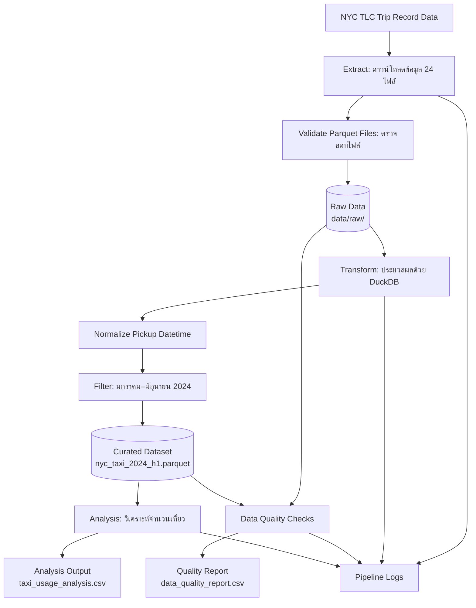

# NYC Taxi Data Pipeline — Data Flow

## Pipeline Architecture

## ขั้นตอนการทำงาน (Pipeline Steps)

1. **Extract — การดึงข้อมูล**
   - ดาวน์โหลดข้อมูลจากแหล่งข้อมูล NYC TLC
   - ดึงข้อมูล Taxi ทั้ง 4 ประเภท ได้แก่ Yellow, Green, FHV และ FHVHV
   - ดาวน์โหลดข้อมูลรายเดือนตั้งแต่มกราคมถึงมิถุนายน 2024 รวมทั้งหมด 24 ไฟล์
   - ตรวจสอบความถูกต้องของไฟล์ด้วย Parquet Validation ก่อนนำไปใช้งาน
   - เก็บไฟล์ต้นฉบับไว้ใน data/raw/

2. **Transform — การประมวลผลข้อมูล**
   - ใช้ DuckDB อ่านและประมวลผลข้อมูลจากไฟล์ Parquet
   - รวมข้อมูลจาก Taxi ทั้ง 4 ประเภทด้วย UNION ALL
   - ปรับชื่อและรูปแบบ Pickup Datetime ให้เป็นมาตรฐานเดียวกัน
   - กรองข้อมูลให้อยู่ในช่วงวันที่ 1 มกราคม ถึงก่อนวันที่ 1 กรกฎาคม 2024
   - ตัดรายการที่มี Pickup Datetime เป็นค่าว่างหรือไม่ถูกต้องออก
   - บันทึกผลลัพธ์เป็น nyc_taxi_2024_h1.parquet ใน data/curated/

3. **Data Quality — การตรวจสอบคุณภาพข้อมูล**
   - ตรวจสอบข้อมูลต้นฉบับและเปรียบเทียบกับ Curated Dataset โดยตรวจสอบ:
   - Missing Pickup: จำนวนรายการที่ไม่มี Pickup Datetime
   - Invalid Pickup: จำนวนรายการที่ไม่สามารถแปลงเป็น Timestamp ได้
   - Out-of-Period: จำนวนรายการที่อยู่นอกช่วงเวลาที่กำหนด
   - Valid Records: จำนวนรายการที่ผ่านเงื่อนไขการกรอง
   - Curated Records: จำนวนรายการใน Curated Dataset
   - ผลการตรวจสอบจะถูกบันทึกใน outputs/quality_reports/data_quality_report.csv โดยแต่ละ Taxi Type ต้องมีจำนวน Valid Records ตรงกับ Curated Records จึงจะผ่านการตรวจสอบ (PASS)

4. **Analysis — การวิเคราะห์ข้อมูล**
   - ใช้ DuckDB วิเคราะห์ข้อมูลจาก Curated Dataset
   - นับจำนวนเที่ยวของ Taxi แต่ละประเภท
   - คำนวณสัดส่วนการใช้งาน (Percentage) และจัดอันดับ (Usage Rank)
   - บันทึกผลลัพธ์ใน outputs/analysis/taxi_usage_analysis.csv
   - ผลการวิเคราะห์พบว่า FHVHV เป็น Taxi Type ที่มีจำนวนรายการมากที่สุด ในช่วงเวลาที่ศึกษา

5. **Pipeline Logs — การบันทึกสถานะ**
   - บันทึกสถานะการทำงานของแต่ละขั้นตอน
   - บันทึกข้อผิดพลาดที่เกิดขึ้นระหว่างการทำงาน
   - บันทึกระยะเวลาการทำงานทั้งหมดของ Pipeline
   - เก็บ Log ไว้ในโฟลเดอร์ logs/
