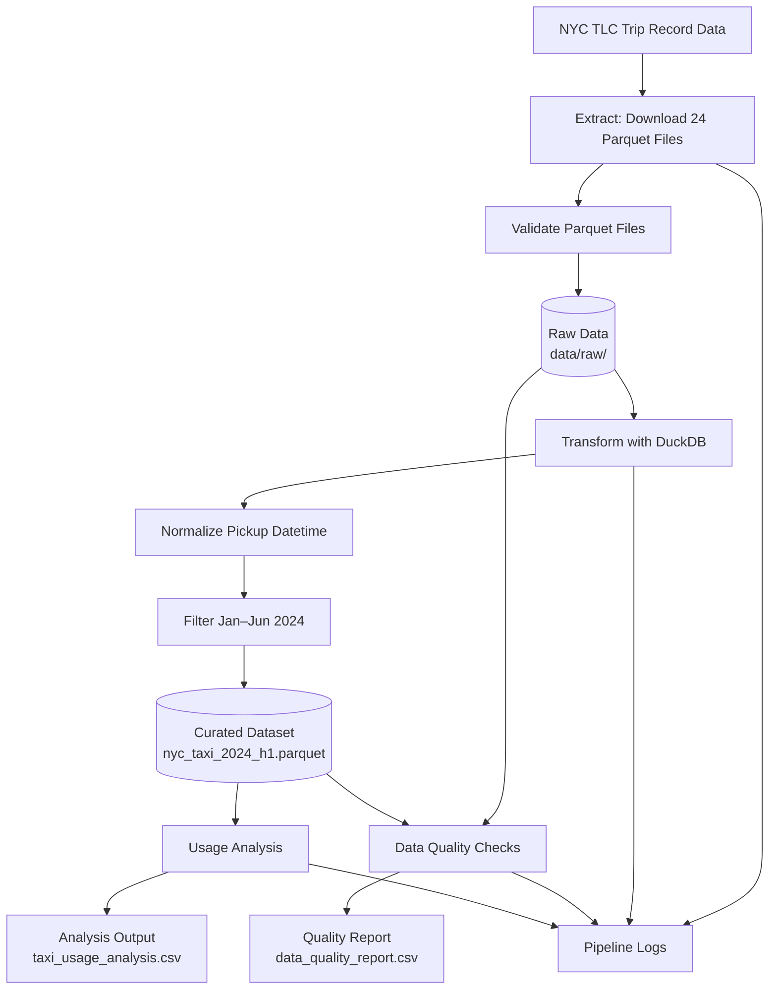

# NYC Taxi Data Pipeline — Data Flow

## Pipeline Architecture

## Pipeline Components

1. **Extract**
   - Downloads monthly Parquet files from NYC TLC.
   - Validates downloaded files before saving them.
   - Reuses existing valid files to avoid unnecessary downloads.

2. **Transform**
   - Uses DuckDB to process large Parquet datasets.
   - Standardizes pickup datetime columns.
   - Filters records to the January–June 2024 period.
   - Saves the curated dataset as Parquet.

3. **Data Quality**
   - Checks missing and invalid pickup timestamps.
   - Checks records outside the analysis period.
   - Compares valid raw record counts with curated record counts.
   - Saves results as a CSV report.

4. **Analysis**
   - Counts records for each taxi type.
   - Calculates each taxi type's percentage of total records.
   - Ranks taxi types by usage.

5. **Logging**
   - Records pipeline execution steps and status.
   - Records successful completion or failure.
